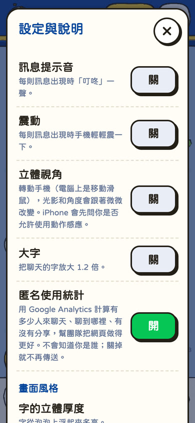
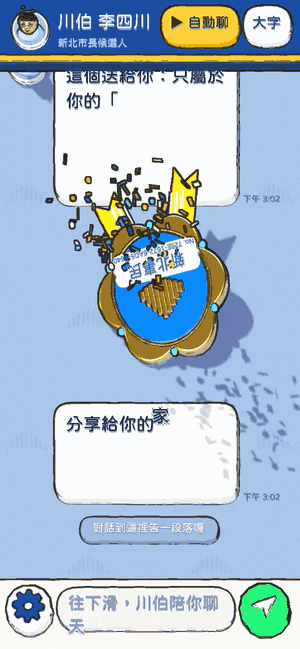

<p align="center">
  
</p>

<h1 align="center">跟川伯聊天</h1>

<p align="center">
  <b>新北市長候選人李四川（川伯）陪你話家常的 3D 聊天室</b><br>
  不用打字，往下滑就好。<br><br>
  <a href="https://hammerlee.tw"><b>👉 打開 hammerlee.tw</b></a>
</p>

---

看起來像 LINE，但畫面上的每個泡泡、每個字、表情、貼圖、照片框，連上面的標題列和下面的輸入列，都是一個個 3D 小模型，用手繪墨線的風格畫出來。
川伯先聊他做過的事，再聊新北的下一段路；每個人聊到的內容和順序都不一樣，聊完還會拿到一枚專屬的「新北事民徽章」。

> **這是支持者 dAAAb 個人出資製作的粉絲創作，不是李四川競選團隊的官方網站。**
> 對話是模擬的：川伯說的每一句，都依據他公開的政見與經歷整理，出處記在 [`research/NOTES.md`](research/NOTES.md)。
> 這個網站從頭到尾是 AI 做的，最初的需求和每次修改都公開在 [製作紀錄](docs/MAKING-OF.md)。

## 為長輩設計

<table>
  <tr>
    <td align="center"></td>
    <td align="center"></td>
    <td align="center"></td>
  </tr>
  <tr>
    <td align="center">往下滑就開始聊</td>
    <td align="center">字大、句子短</td>
    <td align="center">左下角的齒輪是設定</td>
  </tr>
</table>

- **只要往下滑**：川伯會先出現「…」正在輸入；輪到你的時候，字會自己在輸入框裡打出來再送出。不習慣滑的人，點一下送出鈕也會前進。
- **▶ 自動聊**：照長輩閱讀的速度自己播下去；「跟川伯說掰掰」可以直接跳到最後。
- **大字**：聊天的字再放大 1.2 倍。設定裡還能調字的立體厚度、陰影濃淡、手繪感，預設值是最好讀的。
- **字都可以長按選取、複製**：3D 字上面疊了一層對齊的透明文字，螢幕閱讀器也讀得到。
- 點貼圖、照片、長輩圖、政見卡都能放大、下載、分享。
- **在你家擺擺看（AR）**：貼圖、徽章、小川哥的建設模型，可以用手機相機擺在桌上或地上（iPhone 用 Safari，Android 用 Chrome）。

## 小川哥

<p align="center">
  
</p>

小川哥戴著工程帽、拿著鐵鎚、扛著鏟子，三不五時從畫面上跑過去，點他一下會跳起來；點川伯的頭像，他就會跑出來；**長按他**，可以用 AR 把他帶到你家的桌上。
有時候他會停下來敲敲打打，做出一個川伯參與過的建設小模型，點開就是一張可以分享的卡片，收集起來是一本圖鑑。

## 每段對話都獨一無二

<table>
  <tr>
    <td align="center" width="40%"></td>
    <td align="center"></td>
  </tr>
</table>

- 腳本裡每個可以替換的地方都是一個選擇：開場白、每句話的不同說法、表情、貼圖、照片、主題順序……加起來約 **1.66 × 10⁴³** 種不同的對話，遠遠超過新北市約 403 萬人口。
- 一段對話的編號就是這一串選擇本身。把連結傳給朋友，朋友打開會看到一模一樣的對話，看完也能開始自己的。
- 徽章的形狀、金屬、琺瑯配色、圖騰、寶石、緞帶，都由編號決定，每個人的都不一樣。
- 聊完可以傳給 LINE 好友，或下載分享圖、徽章、整段對話的長圖。

## 多支手機一起玩（實驗功能）

把幾支手機並排平放，小川哥會從一支手機的邊緣跑出去，再從隔壁手機跑進來，最多 52 支。
這個功能預設關閉，要在設定裡打開、按下配對才會連線；手機之間只傳臨時的配對碼和小川哥的位置，不用 GPS，也不傳任何個人資料。

## 隱私

- 不用登入，也不用輸入任何資料。
- 聊完只會記錄這段對話的編號、聊到的話題和時間。
- 用 Google Analytics 做匿名使用統計（Google 訊號與廣告個人化都關閉），在設定裡可以關掉。
- 設定只存在你自己的手機裡；立體視角只在你的手機上計算，不會傳出去。
- 11 月 28 日投票日當天，依選舉規定網頁暫停一天；之後會先顯示感謝頁，對話仍然可以回顧。

## 怎麼做的

- **three.js** 斜投影的正交相機，三階平塗材質加上手繪墨線的後製，畫風參考 [Colorfigures](https://april-zhu.com/colorfigures)。
- **3D 中文字**：從 jf 粉圓字型取出用到的字，存成輪廓檔，在手機上即時擠出成立體字；建置時會檢查，缺字就不會上線。
- **對話腳本**是一棵「選擇樹」，對話編號就是一個混合進位的數字，可以完整解碼回整段對話。
- 不用前端框架，整頁壓縮後約 260 KB。網站放在 Vercel，完成的對話記在 Supabase。

更多細節（專案結構、腳本規則、多支手機的運作、上線設定、使用統計事件）：[`docs/TECHNICAL.md`](docs/TECHNICAL.md)。

## 自己跑起來

```bash
npm install
npm run build   # 沒下載字型也能建置，會用已經建好的 public/glyphs.bin
npm run serve   # http://localhost:5173
```

## 這個網站是 AI 做的

由 dAAAb 出題、做決定，程式、3D 模型、對話腳本和上線設定都由 Claude（Claude Code）完成：從第一則需求到 hammerlee.tw 上線約 2 小時。
最初的需求全文、修改次數和時間軸：[`docs/MAKING-OF.md`](docs/MAKING-OF.md)。

## 授權與致謝

- 本專案的程式碼以 [MIT](LICENSE) 授權。
- [three.js](https://threejs.org)、[uqr](https://github.com/unjs/uqr)、[Colorfigures](https://april-zhu.com/colorfigures)（April Zhu、Tolga Cohce）：MIT License。
- [jf 粉圓 Huninn](https://github.com/justfont/Huninn)、[Chiron GoRound TC](https://github.com/chiron-fonts/chiron-go-round-tc)：SIL Open Font License 1.1。
- 完整授權條款見 [`THIRD_PARTY_NOTICES.txt`](THIRD_PARTY_NOTICES.txt)。
- 照片與政見圖卡取自[李四川官方 Portaly](https://portaly.cc/hammerlee)，版權屬原權利人，不在 MIT 授權範圍內；`research/portaly/` 的轉存資料也是。
